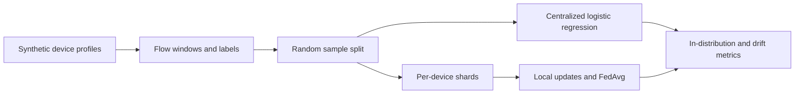
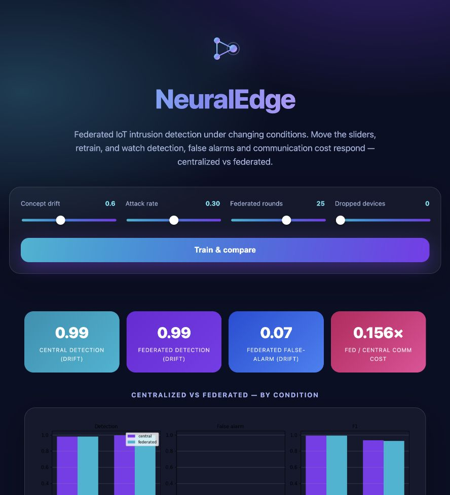

# NeuralEdge-IDS

A reproducible comparison of centralized and federated intrusion-detection training on non-IID synthetic IoT flow windows, including an evaluation on a generated benign-behavior shift.

[](https://github.com/harshacreate/NeuralEdge-IDS/actions/workflows/ci.yml)

## Problem / why it matters

IoT devices have different traffic baselines, and benign behavior can shift after updates or operational changes. This experiment asks how two small classifiers behave when training data is split across device families and then evaluated on a separately generated shifted distribution. It uses no packet capture or live network traffic.

## What I built

The simulator produces per-window flow statistics for cameras, thermostats, locks, and hubs. A centralized NumPy logistic-regression model trains on pooled rows; a federated path trains on per-device shards and averages model updates. Both paths use the same fixed, pre-agreed normalization values, and report detection rate, false-alarm rate, F1, and transmitted float counts.



### Dashboard



## Results / evaluation

**SYNTHETIC only.** Measured locally with `python3 -m experiments.run` (seed 0):

| Model / split | Detection rate | False-alarm rate | F1 | Floats exchanged |
|---|---:|---:|---:|---:|
| Centralized, in-distribution | 0.979 | 0.000 | 0.989 | 9,000 |
| Centralized, generated drift | 0.993 | 0.060 | 0.931 | 9,000 |
| Federated, in-distribution | 0.979 | 0.000 | 0.989 | 1,400 |
| Federated, generated drift | 0.993 | 0.067 | 0.924 | 1,400 |

The communication count is a count of floating-point values, not bytes or total network overhead. Tests: 7 passed.

## Design decisions and lessons to discuss

- Per-device shards make the training data non-IID by construction. The random row split still places each simulated device family on both sides, so the score does not represent generalization to unseen devices.
- Fixed, pre-agreed scaling avoids pooling raw rows just to fit a scaler; the values are hand-set stand-ins, not learned from a real deployment.
- Reporting both false-alarm rate and F1 keeps the drift result interpretable when a detector catches attacks but also alarms on shifted benign traffic.
- Federated updates reduce the reported float count in this setup. This is not a privacy guarantee: there is no differential privacy, secure aggregation, or gradient-leakage analysis.

## Run it

### Docker dashboard

```bash
docker compose up --build
# Open http://127.0.0.1:8094
```

### Local tests and experiment

```bash
python3 -m venv .venv
source .venv/bin/activate
python -m pip install -r requirements.txt
make test
make run
make plot  # optional; writes out/comparison.png
```

## Limitations & next steps

The traffic and drift are generated, the feature set is small, and the random split includes all device families in train and test. Model updates are not protected against inference or tampering. Next steps include a device-group holdout, calibration and confidence intervals over multiple seeds, and a documented public dataset adapter with licensing and feature mapping.

The project does not capture, generate, or transmit live network traffic.
